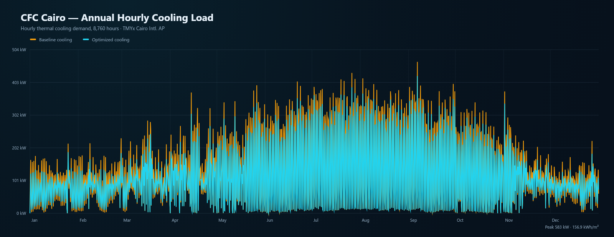

# CFC Cairo · Energy Twin

华为埃及开罗 **CFC 办公楼** 6 层全年冷热负荷仿真与围护结构优化 Agent。项目以 npm workspaces 拆分为**热工内核 / 优化器 / 报表 / Three.js 可视化看板**，用开罗 TMYx 真实逐时气象数据驱动 8,760 小时计算。

**GitHub：** <https://github.com/boriswzb/cfc-cairo-energy-agent>


## 核心能力

- **全年逐时热工仿真**：外墙、屋面、外窗、遮阳、太阳得热、人员、照明、设备、新风/渗透、Openlab IT 散热逐项计算。
- **6 层数字孪生**：0F 大堂/食堂/前台，1F 培训/展区/Openlab，2F–5F 标准办公；每层含电梯厅与左右男/女洗手间，平面布局一致。
- **围护优化 Agent**：192 个候选组合（保温 80/120/160 mm × WWR 22/30/38/46% × 4 种玻璃 × 4 种遮阳），约束热舒适与峰值强度，输出 Pareto 前沿与推荐方案。
- **Three.js 剖切看板**：完整楼宇、屋顶光伏、外遮阳、Openlab；点击外墙/窗/遮阳/光伏/机房查看热工参数；按 0F–5F 剖切查看房间分区。
- **光伏匹配**：160 kWp、20° 南向；逐时自用/上网/电网交换、自消纳率、建筑用电自给率。
- **标准交付物**：逐时/逐月/分层/Openlab CSV，全年逐时与逐月 PNG，Markdown 分析报告。
- **自动校验**：3R2C 稳态与 U·ΔT 校验；开罗 47.2 °C 极端高温测试；全年分项能量平衡；偏差 >5% 自动修正分项。
- **工程化**：Node 单元测试、Worker 后台计算、错误捕获与自动恢复、构建脚本、真实气象数据随仓库提供。

## 快速启动

要求 Node.js ≥ 20。

```bash
git clone https://github.com/boriswzb/cfc-cairo-energy-agent.git
cd cfc-cairo-energy-agent
npm install
npm run dev       # http://127.0.0.1:5174
```

首次打开会在 Web Worker 中执行：基线 8,760 h 仿真 → 192 组合快速筛选 → 2–3 个入围方案全年详算，页面显示进度。完成后即可切换总览、围护优化、光伏匹配、Openlab、报表页面。

```bash
npm test          # 热工内核 + 优化器 + 报表 17 项测试
npm run build     # 生产构建到 apps/web/dist
npm run preview   # 预览构建结果
npm run report    # Node 侧生成 reports/ 下 CSV/PNG/Markdown
```

## 目录结构

```text
cfc-cairo-energy-agent/
├─ data/
│  ├─ cairo_tmyx.epw          # Climate.OneBuilding TMYx 原始 EPW
│  ├─ cairo_hourly.csv        # 8,760 行处理后气象
│  └─ weather-metadata.json
├─ packages/
│  ├─ energy-core/            # @cfc/energy-core
│  │  ├─ src/weather.js       # EPW CSV、太阳位置、坡面辐射
│  │  ├─ src/envelope.js      # 3R2C 围护、玻璃、遮阳
│  │  ├─ src/simulation.js    # 全年逐时负荷 + 光伏匹配
│  │  ├─ src/validation.js    # 极端工况 + 能量平衡
│  │  └─ test/
│  ├─ optimizer/              # @cfc/optimizer
│  │  ├─ src/evaluator.js     # 快速围护响应预计算
│  │  └─ src/optimize.js      # 192 组合搜索 + Pareto + 详算
│  └─ reporting/              # @cfc/reporting
│     ├─ src/csv.js           # CSV 原始数据
│     ├─ src/markdown.js      # Markdown 分析报告
│     └─ src/charts.js        # Node 端 PNG 曲线
├─ apps/web/
│  ├─ src/scene/cfcScene.js   # Three.js 楼宇/剖切/拾取
│  ├─ src/workers/            # 仿真 Worker
│  ├─ src/charts/             # SVG 图表
│  └─ src/components/         # 看板、控制、报表
├─ scripts/
│  ├─ prepare-weather.mjs
│  ├─ sync-weather.mjs
│  └─ generate-report.mjs
├─ docs/                      # 截图、示例报告、示例图表
└─ package.json
```

## 气象数据

- 数据源：**Climate.OneBuilding.Org**，`EGY_QH_Cairo.Intl.AP.623660_TMYx`
- 原始下载：
  <https://climate.onebuilding.org/WMO_Region_1_Africa/EGY_Egypt/QH_Al_Qahirah_Cairo/EGY_QH_Cairo.Intl.AP.623660_TMYx.zip>
- 站点：Cairo Intl. AP，30.122°N / 31.406°E，海拔 116.4 m，UTC+2。
- 处理后 8,760 小时：年均 22.13 °C，最高 42.4 °C，最低 5.2 °C，年水平面总辐射 2,148.5 kWh/m²。
- TMYx 各月来自不同典型年份；为便于可视化，脚本将时间序列映射到非闰年 2023 日历，物理计算保留原始逐时值。
- 原始 EPW 与处理后 CSV 都在 `data/` 中，便于复核与重新生成。

## 物理模型

### 建筑

- 6 层，标准层 45 m × 27 m = 1,215 m²，总建筑面积 7,290 m²。
- 0F：前台/大厅/食堂/部分办公；1F：培训/展区/Openlab/支持间；2F–5F：开放办公、独立办公室、会议室、核心筒。
- 每层电梯厅居中，男/女洗手间分列左右；围护及窗墙比按立面分别计算。
- 工作日按埃及习惯设为**周日至周四**，周五/周六为周末；办公时段 07:00–19:00，Openlab 24/7。

### 围护与辐射

- 围护：3R2C 双质量节点隐式 Euler 逐时模型；稳态 U 与多层构造热阻一致。
- 外墙基准：200 mm 混凝土 + 80 mm 保温 + 内外饰面，U ≈ 0.384 W/(m²·K)。
- 屋面：200 mm 混凝土 + 100 mm XPS，U ≈ 0.29 W/(m²·K)。
- 外窗：Low-E 双银中空（U 1.55、SHGC 0.31）；优化候选含三玻 Low-E、高透 Low-E、普通双玻。
- 外遮阳：无 / 固定 / 季节可调 / 智能时序；智能策略按朝向、月份、时段和 DNI 动态收放。
- 太阳位置：NOAA 近似；由 EPW 的 GHI/DNI/DHI 计算各立面坡面辐射和屋顶 20° 南向光伏坡面辐射。
- 内热/新风：按房型人员密度、照明/设备功率密度、埃及作息和新风量计算；Openlab 单独计量 12 kW IT + 1.5 kW UPS，独立 22 °C 精密空调。

### 负荷

逐时能量平衡：

```text
Q_cool = Σ(围护传热 + 外窗太阳得热 + 人员显热/潜热
            + 照明 + 设备 + 新风/渗透 + Openlab IT/UPS)
```

冷热源电耗按部分负荷 COP、辅机系数与独立 Openlab COP 计算；建筑总用电再与光伏逐时匹配。详细假设与公式见 [示例报告](docs/sample-report.md)。

## 优化结果

当前版本在 192 个组合上得到 **55 个 Pareto 非支配解**，推荐方案：

| 变量 | 基准 | 推荐 |
| --- | --- | --- |
| 外墙保温 | 80 mm | 80 mm |
| 窗墙比 WWR | 38% | 22% |
| 玻璃 | Low-E 双银中空 | 三玻两腔 Low-E |
| 遮阳 | 季节可调 | 智能时序 |
| 全年制冷 | 1,251.7 MWh | 1,129.8 MWh |
| 峰值冷负荷 | 631.3 kW | 583.2 kW |
| 建筑用电 | 1,094.0 MWh | 1,056.4 MWh |
| 光伏自消纳率 | 94.25% | 92.39% |
| 建筑用电自给率 | 23.37% | 23.72% |
| 冷负荷强度 | 173.8 kWh/m² | 156.9 kWh/m² |

**节能率：制冷 −9.7%，峰值 −7.6%，建筑用电 −3.4%。**

重要说明：

- 在开罗干热气候与较高内热背景下，继续加厚外墙保温会减少夜间向室外的散热，对**全年冷负荷**的边际收益为负，因此 Agent 保持 80 mm 既有保温，把优化重点放在窗墙比、玻璃与可调遮阳。
- 围护提效降低白天冷负荷，会让 160 kWp 光伏的**自消纳率**小幅下降约 1.9 个百分点；**建筑用电自给率**反而提升 0.36 个百分点。报告同时给出两个指标，避免用单一指标误导。
- Pareto 前沿可用于选择“节能优先”“消纳优先”或“平衡”方案。若需同时提升自消纳率，可增加午间蓄冷/预冷等负荷迁移措施，本项目在报告中给出建议但未把它作为围护变量。

## 三维看板

- 完整 6 层体量、玻璃幕墙、水平遮阳、屋顶 63 块光伏组件、入口雨棚。
- 点击外墙 / 窗 / 遮阳 / 光伏板 / Openlab，弹出构件热工参数卡。
- 点击 0F–5F 进入楼层剖切：隐去外墙、显示房间分区、颜色区分办公/会议/核心筒/Openlab。
- 鼠标拖拽旋转、滚轮缩放；点击“全楼”回到整体视图。


## 报表

浏览器“报表”页可导出：

- `cfc-hourly.csv`：8,760 行，含气象、冷热负荷、Openlab、光伏、电网交换
- `cfc-monthly.csv`：逐月统计
- `cfc-openlab-*.csv`：机房逐月与得热分项
- `cfc-floors.csv`：0F–5F 分层负荷
- `cfc-scenarios.csv`：基准/优化节能率
- `cfc-annual-hourly.png`、`cfc-monthly.png`：PNG 曲线
- `CFC-Cairo-analysis.md`：12 章分析报告

也可在命令行生成完整样例：

```bash
npm run report
```

输出位于 `reports/`。仓库内示例：[Markdown 报告](docs/sample-report.md)。

## 校验与测试

```bash
npm test
```

覆盖：

- 8,760 小时天气、太阳位置与坡面辐射
- 墙体/屋面 U 值与 47.2 °C 极端高温稳态校验（偏差 <1%）
- 全年冷热负荷、Openlab 独立计量、分项能量平衡
- 能量平衡守卫：偏差 >5% 自动修正分项
- 光伏容量/发电量/自消纳/自给率
- Pareto 支配关系、192 组合搜索、可调遮阳约束、详算推荐
- CSV / Markdown / PNG 输出

当前本机：**17/17 通过**。



## 适用与限制

- 面向方案比较、课堂演示与早期设计决策，不替代施工图阶段的 EnergyPlus/IES 详细建模。
- 采用理想 HVAC 设定点控制；未模拟 VAV 末端、风机盘管、房间空气温度分钟级波动。
- 围护为 3R2C 集总模型；Openlab 围护得热按 1F 面积份额分摊，IT/UPS 单独统计。
- 光伏未考虑屋顶设备、女儿墙、局部阴影；实际设计需按屋顶布置复核。
- 室内热舒适采用 24 °C 制冷设定点、30–60% RH、峰值冷负荷强度约束的工程简化判据，未做完整 Fanger PMV 场分析。

## 数据来源与引用

- Climate.OneBuilding.Org, *EGY_QH_Cairo.Intl.AP.623660_TMYx*, typical meteorological year, Cairo International Airport.
- ASHRAE Handbook—Fundamentals 2025 design conditions (EPW header).
- 埃及工作日习惯：周日至周四。
